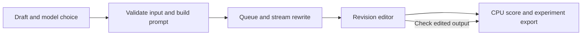

# Personal Writing Style AI · Writing Desk

Writing Desk is a web app for turning a draft into a clearer, more natural revision without losing the original meaning. I built it for my IT 287 independent study at Illinois State University. It started as a notebook that used examples of my own writing. The current version is a hosted editor where you can compare two fine-tuned models on the same draft.

**[Try Writing Desk on Hugging Face](https://huggingface.co/spaces/ewbaer/personal-writing-style-ai)**

## Using the app

1. Paste a draft into **Original**.
2. Pick **Qwen · ARM 1** or **Ministral · ARM 2** in the **Model** dropdown, choose a writing style, and click **Rewrite**.
3. Read the streamed result in **Revision**. Check that it kept the original facts, names, numbers, and meaning.
4. Edit the result directly if you want. Use **Check edited output** to score the edited version without generating another rewrite. **Score details → Download experiment data (JSON)** saves the input, output, edits, scores, and run settings.

The editor also has light and dark themes, word counts, a copy button, and a cancel control. No local GPU or personal API key is needed to open the hosted demo.

## Models and training

| Option | Base model | Training |
| --- | --- | --- |
| Qwen · ARM 1 | `Qwen/Qwen2.5-3B-Instruct` | Fine-tuned on a desktop RTX 5070 Ti |
| Ministral · ARM 2 | `mistralai/Ministral-3-8B-Instruct-2512-BF16` | Fine-tuned on an NVIDIA A30 through TAMU LAUNCH |

Both models use **supervised fine-tuning (SFT) with QLoRA**. I trained a small set of adapter weights for each model using paired drafts and target rewrites prepared from [humanizer-data](https://huggingface.co/datasets/jialinyyzz/humanizer-data). Both runs started from the same prepared splits; the models' different tokenizers meant a few long examples were filtered differently. These runs used SFT. DPO was part of the original project plan.

ARM 2 used 3,886 training examples and 569 validation examples. It finished one epoch in 486 steps, with a final logged validation loss of 0.6678. I verified that the hosted app loaded the trained ARM 2 adapter by checking `"adapter_loaded": true` in a real rewrite export. Validation loss measures how well the model predicts the target text; it doesn't tell me whether someone would prefer its rewrites.

## What the detector score means

**Writing signals** uses a separate classifier that runs on CPU. TF-IDF turns words and short phrases into numeric features, and logistic regression uses those features to score how AI-like the passage looks. **Lower means the classifier saw fewer AI-like signals.** A score of 86.7/100 does not mean 86.7% of the text was written by AI.

The app shows the whole-passage score separately from experimental sentence checks. The classifier was trained on passages, so sentence flags can disagree with the passage score and shouldn't be treated as proof of authorship.

In one hosted ARM 2 run, the original draft scored **74.2** and the rewrite scored **86.7**, an increase of **12.5 points**. That's one result from one draft. To compare the models fairly, I use the same held-out input and writing style setting for both, then check naturalness, missing details, added claims, and changes in meaning alongside the detector scores.

## How the app works



Every rewrite goes through input validation, prompt building, the GPU queue, and the revision editor. The selected model determines which adapter is used. Example prompting is optional when available. The detector can run again after an edit without using the GPU.

| Part | What it does |
| --- | --- |
| Gradio interface | Manages the two editors, model dropdown, and each visitor's session |
| Rewrite engine | Builds the prompt and streams the selected model's output on ZeroGPU |
| Writing signals | Scores the original, revision, or edited text on CPU |
| Experiment export | Saves the run ID, model, adapter status, scores, and timing for comparison |

## Run it locally

The GitHub repo contains the earlier Windows Flask app at the root and a snapshot of the hosted Gradio app in `hosted/`. The live Space is the easiest way to try the deployed adapters. Changes made in Hugging Face do not automatically sync to GitHub.

```powershell
git clone https://github.com/ewbaer/Personal-Writing-Style-AI.git
cd Personal-Writing-Style-AI
```

For the earlier Flask version, run `.\setup_windows.bat` once, then `.\start_app.bat`. For the Gradio snapshot, use the dependencies and launch instructions in [hosted/README.md](hosted/README.md). Local runs use your own hardware. The trained rewrite adapters are stored separately on Hugging Face; a deployment that loads the private adapters needs an `HF_TOKEN` with read access, stored as a Space secret.

## Limits and next steps

Multiple visitors can open the Space at once, but GPU rewrites run one at a time. Queue time, cold startup, and ZeroGPU quotas affect how long a visitor waits. The export records time to first token and generation time. The app does not call a paid rewrite or detector API.

The hosted app rejects empty drafts and drafts above 1,000 words. The detector needs at least 50 words; if a check fails, you can still keep the rewrite. Output can also be cut short by the generation limit. Download results you want to keep, since the app doesn't provide permanent session history.

My next priorities are a repeatable comparison on held-out drafts, separate testing for detector false positives, and a small classroom load test.
