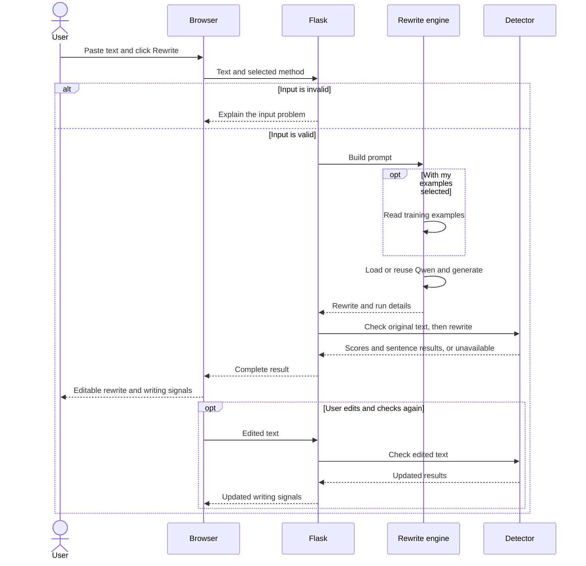
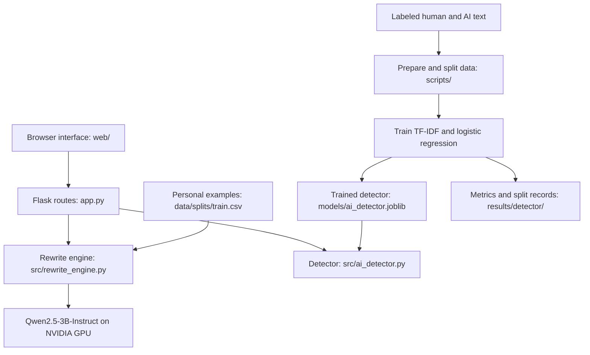

# Personal Writing Style AI

A local Python/Flask app that rewrites text using Qwen2.5-3B-Instruct and optional examples of my writing. The goal is to match the user's style while keeping the original meaning.

**To run or restore the project, read [docs/RESTORE.md](docs/RESTORE.md).**

## Current state

The rewriting model uses prompting. It has not been DPO-trained. General rewrite uses instructions; My examples adds up to three writing pairs from the training split and excludes a matching input. This is fixed example prompting, not retrieval or model training.

The app has a two-column editor, editable output, word counts, a copy button, light/dark mode, JSON export and a local AI detector. Highlight sentences is a toggle inside the revision editor. Editing clears stale highlights until the text is checked again.

Qwen runs on an NVIDIA GPU. Large GPUs use full weights; GPUs under 10 GB use 4-bit weights. The model downloads once to the normal Hugging Face cache and reloads into GPU memory when the app restarts.

## Writing data

There are ten LinkedIn pairs with `ID`, `Type`, `AI Version` and `Ethan Rewrite` columns. The saved split has six training pairs, two validation pairs and two test pairs. The app reads only the training split. This is enough to test the workflow, not enough to draw strong conclusions about personal style training.

The notebook and early experiments remain in `notebooks` and `results`. Student rewrites and public data should be reviewed and kept separate from my personal style examples.

## Local detector

The detector uses TF-IDF word and two-word phrase features with logistic regression. The preparation script reads the public `AI_Human.csv` dataset, filters length, removes exact normalized duplicates and samples up to 10,000 human and 10,000 AI passages. Related examples need shared group IDs where those are available. Hash IDs cannot prevent related authors or prompts from crossing splits when the source lacks those IDs.

Training uses five group-separated folds: three for training, one for validation and one for testing. The fitted vocabulary comes only from training. Reports include accuracy, false positives, AI recall, ROC AUC, Brier score and a split manifest.

The original October 15 report is archived in `results/detector_previous_run`. It reported about 98.9% test accuracy on that dataset. It does not establish accuracy on LinkedIn posts, rewritten text or individual sentences.

**The trained `models/ai_detector.joblib` file and large detector dataset are not included.** Restore the model from the laptop or use the included scripts to retrain. The app can rewrite without a detector.

## Scores and highlights

The main status shows `Text flagged as AI-like`: words in flagged sentences divided by all words. The whole-passage classifier score is separate under Score details. Neither number proves authorship.

Sentences of eight or more words are checked individually using the same passage classifier, with a 0.5 cutoff. Shorter fragments are unassessed. Sentence accuracy and the cutoff have not been validated on sentence-labeled data. No rule forces a set number of highlights, and a full-text score can differ from the share of text flagged.

The detector uses its learned vocabulary and classifier. It does not reproduce ZeroGPT, measure perplexity/burstiness, or call an external detection API.

## Files

| File or folder | Purpose |
|---|---|
| `app.py` | Local Flask app and rewrite endpoint |
| `src/rewrite_engine.py` | Qwen loading, prompts and generation |
| `src/ai_detector.py` | Detector loading, sentence results and API routes |
| `web/` | Editor, theme, controls and inline highlights |
| `setup_windows.bat` | Environment setup and GPU check |
| `start_app.bat` | App launcher |
| `scripts/train_detector.bat` | Prepare data and train a missing detector |
| `scripts/prepare_detector_data.py` | Public CSV filtering and sampling |
| `scripts/train_detector.py` | Fit, test and save the detector |
| `data/` | Personal writing pairs and splits |
| `notebooks/` | Original data checks and experiments |
| `results/` | Saved experiments and archived training report |
| `tests/` | Server, training pipeline and browser-logic checks |

## Saved results

The JSON export keeps the input, generated output, edited output, prompting method, example IDs, model, precision, token counts and generation time. It also keeps the original detector results and the latest edited-output check when it matches the current editor text. Editing does not retrain either model.

Generation time excludes model loading and tokenization. Compare the same precision, prompts and generation settings across experiments. Inputs over 1,000 words or 20,000 characters are rejected; prompts above 7,000 tokens are rejected instead of silently truncated.

## Next steps

Evaluate the detector on separate LinkedIn writing, review more rewrite pairs, prepare DPO preferences and compare trained rewrites with the prompting baseline on held-out inputs. A second model or training method is still to be finalized.

## Folder layout

The root keeps the Flask entry point, README, requirements and Windows launchers.
`src` contains the rewriting and detection code. `scripts` contains data preparation,
training and the GPU check. `web` contains the interface. `docs` contains setup and
verification notes. `requirements` contains detector-only and development dependencies.
The optional Node test configuration lives in `tests`.

Start the app from the root with `start_app.bat`. To train a missing detector, run
`scripts\train_detector.bat` in PowerShell. This cleanup does not retrain either model.

## Architecture and Non-Functional Requirements

This section describes the working local app. The rewrite model currently uses prompts and writing examples. The detector has been trained separately. DPO training for the rewrite model is still planned.

### 1. How a request travels through the app

The user pastes text into the browser, chooses a method and clicks **Rewrite**. The browser sends the text to Flask. Flask checks the input, builds the prompt and asks Qwen to rewrite it on the GPU. The app then attempts to score the original text and the rewrite with the local detector before returning the result.

| Route | Components and conditions |
| --- | --- |
| Every rewrite request | Browser, Flask endpoint and input checks. Invalid requests stop here. |
| Every valid rewrite | Rewrite engine, prompt builder and Qwen on the GPU. The detector hook then attempts to check both texts. |
| With my examples | The prompt builder reads the training CSV and adds up to three examples, excluding an exact match to the input. This is fixed example prompting, not RAG. |
| First rewrite after starting the app | The rewrite engine loads Qwen into GPU memory. Missing weights must first be downloaded. Later rewrites reuse the loaded model. |
| Smaller GPU | Automatic precision selection uses 4-bit weights when total GPU memory is below 10 GB. |
| Detector available and text long enough | The detector returns a document score and sentence results. Missing detector files or text below 50 words produce an unavailable result rather than stopping a successful rewrite. |
| Check edited output | The browser sends the edited text directly to the detector. Qwen does not run again. |
| Highlight sentences | The interface uses sentence results to toggle highlights inside the revision editor. If a fresh check is needed, it requests one. |

There is no agent making probabilistic routing choices. The paths above are controlled by code and user choices. Qwen's wording and the detector's scores come from learned models. Rewrite generation currently uses `do_sample=False`.

The server runs generation and the two detector checks in sequence. They are not parallel processes. The browser waits asynchronously, but the complete response appears only after the server finishes.

### 2. Request sequence



If generation fails, Flask returns an error instead of a rewrite. A detector failure can leave the rewrite available with no score.

### 3. Application architecture



The browser handles editing, themes, word counts, copying, JSON downloads and highlights. Flask connects the interface to the two models. Shared file paths live in `src/paths.py`. Detector training runs offline through the scripts, not during a rewrite. Saving or editing a response does not retrain either model.

### 4. Must-have and nice-to-have features

**Must-have features**

| Feature | Current status |
| --- | --- |
| Rewrite pasted text using a local model | Working |
| Compare general instructions with personal writing examples | Working |
| Keep the input and editable revision side by side | Working |
| Show word counts, copy text and export results | Working |
| Check original and revised writing with a locally trained detector | Working; needs testing on separate writing |
| Toggle sentence highlights and recheck edited text | Working; sentence results still need validation |
| Handle bad input and explain model or detector failures | Implemented |
| Provide clone, setup and launch steps | Included below |
| Train with DPO and compare against the prompted baseline on held-out examples | Planned; not completed |

**Top three nice-to-have features**

1. Retrieve relevant writing examples instead of always taking the first available examples.
2. Save separate user style profiles and collect edits for later training.
3. Stream the rewrite as it is generated so users can start reading sooner.

### 5. Edge cases and limits

| Situation | Current behavior or limit |
| --- | --- |
| Empty input, wrong data type or malformed JSON | Reject the request with an error. |
| Input exceeds 1,000 words or 20,000 characters | Reject the rewrite request. |
| The complete prompt exceeds 7,000 tokens | Reject it rather than silently dropping text. |
| Another rewrite is already running | Reject the second rewrite as busy. There is no request queue yet. |
| No supported GPU, not enough free memory or model download fails | Return a model-loading or generation error. There is no CPU rewrite fallback. |
| Examples are requested but the training CSV is missing or unusable | Return an error. The user can choose the general rewrite method instead. |
| Detector model is missing or a detector check fails | A successful rewrite can still be returned, but detection is unavailable. |
| Text has fewer than 50 words or exceeds 30,000 characters | The detector does not provide its normal score. |
| A sentence has fewer than eight words | It is not scored separately for highlighting. |
| Generation reaches its output limit | The result is marked as truncated and may be incomplete. |
| Input contains instructions aimed at changing the system's task | The prompt tells Qwen to treat pasted text as data. This does not guarantee that every prompt injection will fail. |
| Non-English text, code, unfamiliar topics or very different writing styles | Results have not been validated for these cases and should not be treated as reliable. |

### 6. How output is evaluated

**Rewrite quality:** Compare the original and revision for preserved facts, meaning and important details. Check whether the model added claims, changed who did something or removed needed information. Rate how closely each result matches the user's wording, tone and sentence structure. Compare the general prompt, example prompt and future DPO model on the same inputs kept out of training. Human review is still needed because the app does not automatically verify facts or meaning.

**Detector quality:** Measure accuracy, precision, recall and false positives on labeled text kept out of training. Also test on a separate source, including LinkedIn-style writing, because strong results on the training dataset's test split do not prove it works equally well elsewhere. Related texts and authors should be kept together when possible to reduce overlap between training and evaluation.

The document score is a model score from 0 to 100, not a verified percentage of words written by AI. Highlight coverage measures how much text falls in flagged sentences. It is a different measurement, so a score of 77 does not mean exactly 77% of sentences should be highlighted. The sentence checks currently reuse a classifier trained on passages and need separate evaluation. Detector scores alone will not be used as proof that a rewrite is good or bad.

**Performance:** Record full response time, generation time, input and output token counts, GPU memory use and errors. Keep the GPU, precision and generation settings the same when comparing methods.

### 7. Clone and run

The current setup targets Windows with Git, Python 3.11 (64-bit), an NVIDIA GPU and a compatible NVIDIA driver. Internet access is needed to install packages and download Qwen the first time. Allow storage for the Python environment and several GB of model weights. Local rewriting and detection do not require a paid API or an API key.

Open PowerShell in the folder where you want the project, then run:

```powershell
git clone https://github.com/ewbaer/Personal-Writing-Style-AI.git
cd Personal-Writing-Style-AI
.\setup_windows.bat
```

Wait for setup and the GPU check to finish successfully. Then start the app:

```powershell
.\start_app.bat
```

Open `http://127.0.0.1:7860` if the browser does not open automatically. The first rewrite can take longer because the model must download if it is not cached, then load into GPU memory. Restarting the app loads the weights into memory again, but normally does not download them again.

**Restore or train the detector:** The trained detector and large source dataset are not included in Git. Copy your own trusted `ai_detector.joblib` into `models/`, or download `AI_Human.csv` from the [AI vs Human Text dataset](https://www.kaggle.com/datasets/shanegerami/ai-vs-human-text), place it in `data/` and run:

```powershell
.\scripts\train_detector.bat
```

This prepares the data if needed and trains the detector locally. Restart the app afterward. The launcher will not overwrite an existing detector. Only load model files you trust. See [setup instructions](docs/SETUP.md) and [restore instructions](docs/RESTORE.md) for more detail. Each computer needs its own environment; do not copy `.venv` between computers.

### 8. Limited public deployment

The current Flask application runs locally. A public version supporting 5–15 users has not been verified for this version of the app.

For the extra-credit deployment, the plan is to use a GPU host, HTTPS and a production server, with access limited to the test group. It will need a request queue, clear busy/error messages, request limits and separate handling of each user's writing examples. A single model-serving worker should own the GPU so multiple server workers do not each load a copy of Qwen. Testing with 5, 10 and 15 clients will show the actual wait times and failure rate before claiming support for that many users.

### 9. Cost, reliability and speed

| Requirement | Current state and how it will be checked |
| --- | --- |
| Cost | Local use has no per-request API fee. Costs include the computer, electricity, storage and internet. Public GPU hosting costs are not known until a host and running schedule are chosen. |
| Reliability | Input checks, error responses and a generation lock are implemented. Tests cover server behavior, detector training and interface logic. These checks do not guarantee factual or stylistic correctness. Human review and evaluation on separate data are still needed. |
| Time to first token | The app does not stream tokens, so users currently see the result only after generation and detector checks finish. Time to first token has not been measured. |
| Full response time | Depends on input size, output length, prompting method, GPU, precision and whether the model is already loaded. The saved `seconds` field measures generation only, not the complete browser-to-result time. |
| Capacity | One rewrite runs at a time per process. Multi-user load and queue behavior are not implemented or benchmarked yet. |

The next speed test will use the same roughly 250-word inputs for both prompting methods, with cold-start and warm-model runs recorded separately. It will report median and 95th-percentile full response time, detector time, generation speed and GPU memory use. No fixed response-time target or public-user capacity is claimed as achieved yet.
