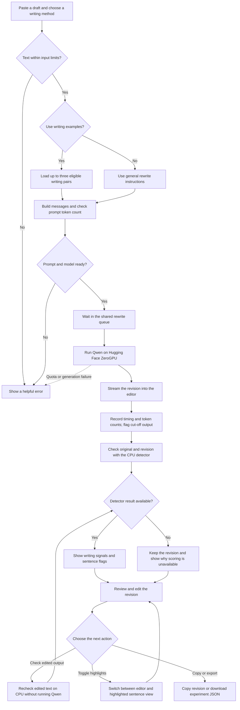
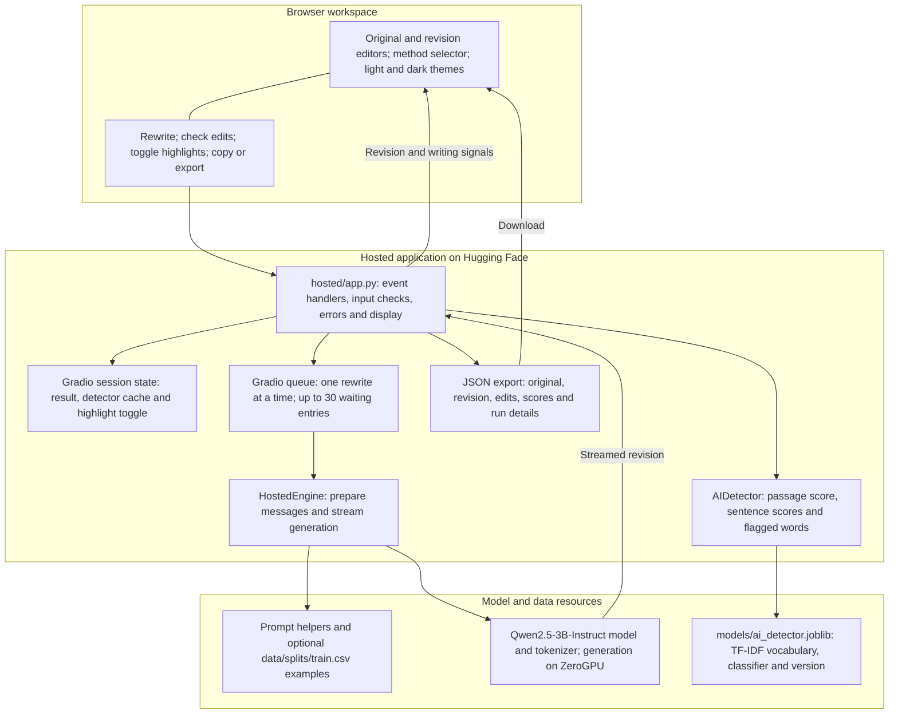
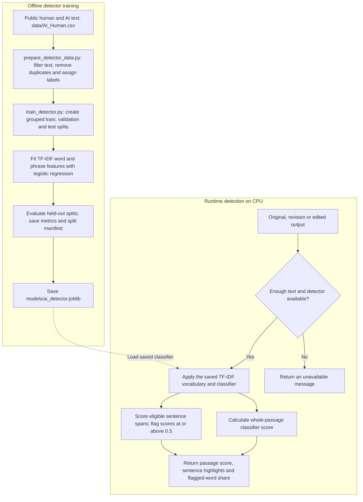

# Personal Writing Style AI

A writing app that rewrites a draft in natural language and checks the result with a trained AI-text classifier. The project started with personal writing examples and now focuses on general rewriting that keeps the original meaning.

**[Open the live app](https://huggingface.co/spaces/ewbaer/personal-writing-style-ai)**

## Current version

The latest working interface and hosted code are in [`hosted/`](hosted/). This folder is a snapshot of the Hugging Face Space. The root-level Flask app, `web/`, and launcher are the earlier local version and have not been replaced by this update.

The hosted app includes:

- Side-by-side original and revision editors, streamed output, and light/dark themes.
- General rewriting or optional example prompting.
- Word counts, editable output, copy and experiment export controls.
- Writing signals, checks of edited output, and sentence highlighting.
- Qwen2.5-3B-Instruct for rewriting on Hugging Face ZeroGPU.
- A saved TF-IDF and logistic regression detector that runs on CPU.

## Training progress

The hosted rewrite model currently uses prompting. It does **not** load the new SFT adapter.

A separate desktop run completed supervised fine-tuning (SFT) of Qwen2.5-3B-Instruct using QLoRA, which trains a small adapter while loading the base model in 4-bit precision. The run used 3,888 training pairs and 569 validation pairs prepared from the redistributable portion of [jialinyyzz/humanizer-data](https://huggingface.co/datasets/jialinyyzz/humanizer-data). License and source information should be retained for each record.

The run finished one epoch with validation loss about 0.763 and peak GPU memory about 6.37 GB. Loss measures prediction of the target text; it does not measure how human the writing sounds. Early comparisons showed mixed results, including formatting problems, so the adapter needs more review before deployment. DPO training has not started. These training results are reported from the desktop run; the adapter and new training files are not included in this hosted snapshot.

## Using the app

Open the live link, paste a draft, choose the rewrite method, and select Rewrite. Review the output for changed facts or missing details. You can edit the revision, check it again, and toggle sentence highlights.

The detector score is a classifier estimate. It does not prove who wrote a passage or measure the percentage of words written by AI. Sentence highlights are separate local estimates and need not match the document score.

## Multiple users

Multiple visitors can open the app at once. Gradio keeps the revision, detector cache, and highlight state in each browser session. The shared model handles one rewrite at a time, with up to 30 waiting queue entries. Detector events permit two simultaneous checks. A queued request may wait longer when others are using the app.

This is shared access, not simultaneous GPU generation. Actual availability also depends on Hugging Face scheduling and visitor GPU quotas. A 5 to 15 person classroom load test has not been established by this source review.

## Clone and run

For class use, the live app needs no local Python installation or GPU.

```powershell
git clone https://github.com/ewbaer/Personal-Writing-Style-AI.git
cd Personal-Writing-Style-AI
```

To run the hosted code locally, use a separate environment. The hosted dependency versions differ from the desktop training environment. A GPU with enough memory for the full model is recommended; the 6 GB laptop GPU is not a good fit for this version.

```powershell
cd hosted
py -3.12 -m venv .venv
.\.venv\Scripts\python.exe -m pip install --upgrade pip
.\.venv\Scripts\python.exe -m pip install -r requirements.txt gradio==6.30.0
.\.venv\Scripts\python.exe app.py
```

Open the local URL printed in the terminal, normally http://127.0.0.1:7860. Local execution uses your computer's resources. ZeroGPU processing requires running on a ZeroGPU Space. Dependencies and GPU compatibility must be checked on the target machine; this update was syntax-checked, not run on a local GPU.

No API key is needed for the included public model and example file. Optional private examples require `WRITING_EXAMPLES_REPO` and an `HF_TOKEN` with read access. Keep tokens out of source control. The trained detector is included at `hosted/models/ai_detector.joblib`.

## Request flow and components

### Rewrite workflow

This is the current hosted workflow. Input checks and step order are controlled by Python. Qwen generates the rewrite; it does not choose tools or run commands.



Input limits are 1,000 words and 20,000 characters. The completed prompt must fit within 7,000 tokens. Example loading is conditional on the selected method; missing or unusable examples stop that request. The model loads once at app startup, rather than downloading for every rewrite. Generation is limited to 1,200 new tokens by default.

A detector failure does not discard a completed rewrite. Short text, missing model files, or scoring errors produce an unavailable status. The detector needs at least 50 words. Editing marks the previous result as stale until the user checks it again.

### Hosted architecture

The browser talks to Gradio event handlers. One shared rewrite model serves queued requests, while each browser session has its own result and detector cache.



| Component | Main file or function | What it handles |
| --- | --- | --- |
| Interface and workflow | `hosted/app.py`, `on_rewrite()` | Validates the draft, streams output, runs detection, and updates the UI. |
| Model inference | `hosted/src/hosted_engine.py`, `HostedEngine.prepare()` and `stream()` | Builds tokenized input, checks context length, runs Qwen, and records timing. |
| Prompt construction | `hosted/src/rewrite_engine.py`, `build_messages()` and `load_examples()` | General instructions or up to three example pairs; this is example prompting, not RAG. |
| Writing signals | `hosted/src/ai_detector.py`, `AIDetector.score()` and `explain()` | Loads the trained classifier and checks passage and sentence patterns on CPU. |
| Edited output | `hosted/app.py`, `on_edit()` and `on_check()` | Marks old scores as stale and checks the revised text without another generation call. |
| Session state | `gr.State` in `hosted/app.py` | Keeps each visitor's current result, detector cache, and highlight state. It is not durable history. |
| Experiment export | `hosted/app.py`, `on_export()` | Creates a downloadable JSON record with the original, output, edits, scores, and run details. |

The earlier local app still uses Flask, `RewriteEngine`, and a local NVIDIA GPU. Its routes include `/api/rewrite` and `/api/detect-details`. Those routes belong to the older implementation and are not the request interface for the hosted Gradio app. Optional private examples can be downloaded from a Hugging Face dataset using the configured secrets.

### Detector training and scoring

Detector training happens separately from normal app use. Visitors use the saved classifier; their requests do not retrain it.



TF-IDF measures words and short phrases using a vocabulary learned during training. Logistic regression uses those features to estimate the AI class. The passage score and the share of words in flagged sentences are different measures. They can disagree because the classifier scores passages and individual sentences separately. Sentence fragments shorter than eight words are left unassessed.

The detector was trained on passages, so sentence highlighting is an experimental use of that classifier. A high score or highlighted sentence is a review signal, not verified authorship. The runtime code does not use perplexity, burstiness, an external detection API, or an automatic rewrite-until-passing loop.

## Features and limits

Must-have features already working in the hosted implementation are rewriting, editable output, detector checks, highlighting, and shared queued access. The top three planned additions are a reviewed trained rewrite adapter, a repeatable evaluation report, and stronger multi-user testing.

Empty input, more than 1,000 words, more than 20,000 characters, and prompts over the token limit are rejected. Detector text under 50 words is not scored. Missing example files can block example prompting. Quota limits, model loading failures, and GPU errors can prevent a rewrite. Output is limited to 1,200 new tokens by default and may be cut off.

## Evaluation, reliability, speed, and cost

Compare the prompted base model and trained adapter on the same held-out inputs. Review naturalness, preserved names/numbers/facts, omissions, added claims, and formatting. Keep test inputs out of training and do not use detector scores as the only quality measure. Evaluate the detector separately with held-out human and AI text, including false positives.

The app records generation timing and time to first token. Queue wait and cold startup can increase the time a visitor waits. Measure these on the hosted hardware rather than treating desktop training or comparison timings as hosted performance. Generation can change meaning, and detector errors are expected, so users need to review the result.

The project does not call a paid rewrite or detection API. Hosting access and quotas depend on the Hugging Face account and Space hardware. Local runs use electricity, storage, and GPU memory. Limited public access is available at the live link; classroom capacity still needs a real load test.

## Source snapshot

The hosted source was copied from Hugging Face commit `8256323` on October 22, 2026. See `docs/HOSTED_SYNC.json` for the full commit and file hashes. Future edits on Hugging Face will not automatically update GitHub.
