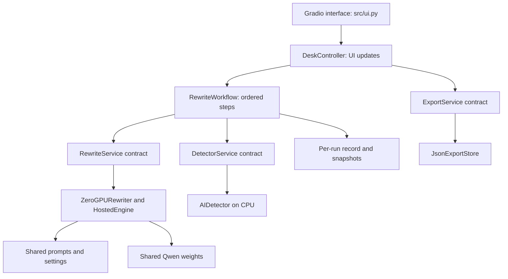
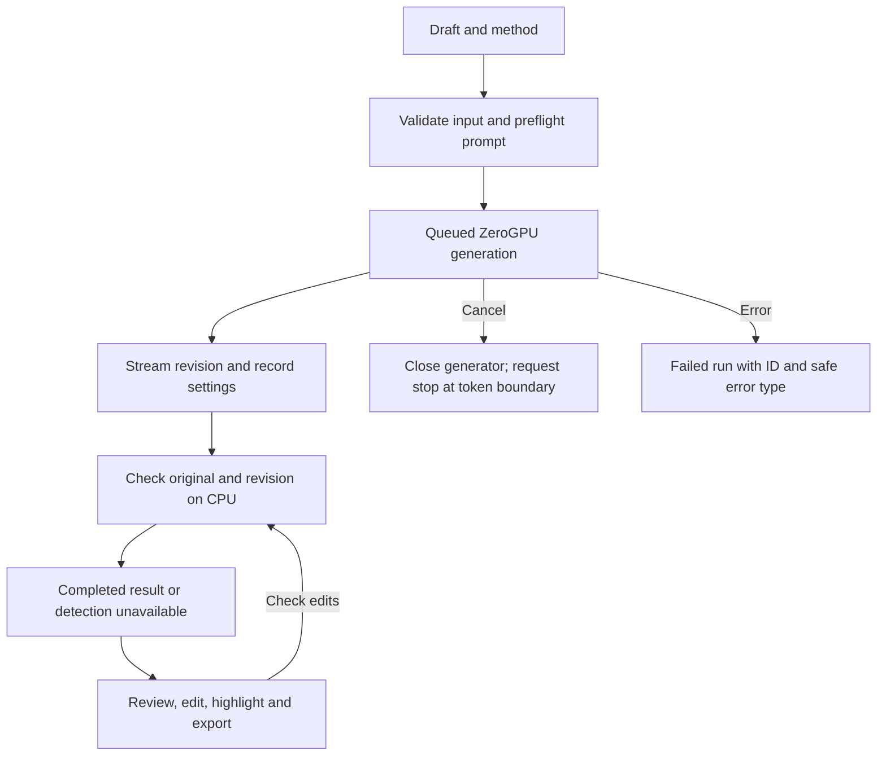

# Architecture review

This describes the shipped refactor, not a proposed design. Prompt wording, example data, the detector artifact, and the editor theme are retained from Space commit `8256323`.

## Components

The entry point creates shared services and injects them into the controller. `build_app(controller)` can instead receive fake services for tests. Services use Python Protocols rather than depending on Gradio. `src/presentation.py` formats UI output; styles and theme JavaScript live in `web/`.

## Workflow

Gradio queues one rewrite at a time, with up to 30 waiting entries. Detector event handlers allow two queued events concurrently; the saved model is shared. The detector's internal load/scoring lock can serialize parts of scoring. Each session has its own Gradio result/cache/highlight state. No global draft history or global current-user record exists.

Cancellation uses Gradio's event cancellation, generator cleanup and a Transformers stopping criterion. It is cooperative: an already executing token or CUDA operation can finish before the worker stops. Queued requests can be cancelled too. Clear also cancels the rewrite event. Mid-generation pause/resume and restart recovery are not implemented.

## State and recovery

`src/records.py` creates a UUID run ID, schema version, prompt version, model ID, adapter field, status, timestamps, settings, completed steps, retries and errors. Every workflow event is a deep-copied snapshot. Model metadata, timings, token counts and detection results are added as steps finish. Errors record the step and exception type, without exception contents or draft text in logs.

Detection failure leaves a completed rewrite in the editor. Check edited output reruns only detection. A fresh cached check is included in exports; an unchanged failed-detection result can be marked completed after a successful recheck. An edited draft is saved separately from the original model output. CPU detection retries only `TimeoutError` and `ConnectionError`, once per check. Generation, quota failures and malformed input are not automatically retried.

There is no durable run-history database. Gradio session state is lost on refresh/restart. Exports are explicit downloads with unpredictable UUID names. App export cleanup removes files older than 24 hours on the next export; Gradio also checks its served-file cache hourly for files older than 24 hours. This is not a guaranteed deletion time or access-control system. Gradio file URLs should be treated as private download links, not accounts or a protected history API. Private example secrets remain optional.

## Seven design principles

| Principle | Implementation and practical limit |
| --- | --- |
| Separation of concerns | `ui.py`, `controller.py`, `workflow.py`, `presentation.py`, `exports.py`, `config.py` split UI, decisions, formatting and storage. |
| Abstraction | Rewrite, detector and export Protocols specify the service boundaries. |
| Low coupling | Constructor injection allows fake or replacement services without editing the workflow. Model adapters must return the documented generation fields. |
| High cohesion | Each module groups related behavior; `app.py` is composition and launch only. |
| DRY | Prompts and input/model limits are shared by local and hosted engines. Validation repeats at entry and GPU boundaries intentionally. |
| Single responsibility | Run records, exports, presentation and inference have separate reasons to change. |
| Dependency inversion | Workflow/controller use injected services, production specifics are constructed in `runtime.py`. |

## Twelve HumanLayer factors

| Factor | Assessment |
| --- | --- |
| Natural language to tool calls | Not applicable. User buttons select the operation; model output is text. |
| Own prompts | `prompts.py` stores instructions and `PROMPT_VERSION`; exports record it. |
| Own context | Shared word/character/token/example limits; complete prompt checked before generation, no silent input truncation. |
| Tools as structured outputs | Not applicable to model actions. Python constructs result records; no generated commands execute. |
| Unify state | One run record carries status and output; UI state is per-session snapshots. |
| Launch/pause/resume | Start and cancel are wired; progress streams. Completed detection can be rechecked. No token-level pause/resume or durable restart recovery. |
| Contact humans via tools | Not applicable. Review and edits happen directly in the UI; no outside action requires approval. |
| Own control flow | Workflow explicitly controls order, stopping and retry policy. |
| Compact model error context | Not applicable to a recovery agent. Short UI errors and structured error records support manual recovery. |
| Small focused agents | Qwen only rewrites. Checks, scoring, counting and exports use ordinary code/classification. |
| Trigger from anywhere | Browser events use the same injectable workflow tests use. No scheduler added. |
| Stateless reducer | Explicit run records and copied events; shared model weights contain no session text. Session state is intentionally not durable. |

## Remaining checks after deployment

A real ZeroGPU generation and cancellation test, a 5 to 15 visitor load test, and full visual checks on desktop/mobile still need to be done on the live Space. This refactor does not establish detector accuracy or better rewrite quality, does not load the desktop SFT adapter, and does not perform DPO training.
